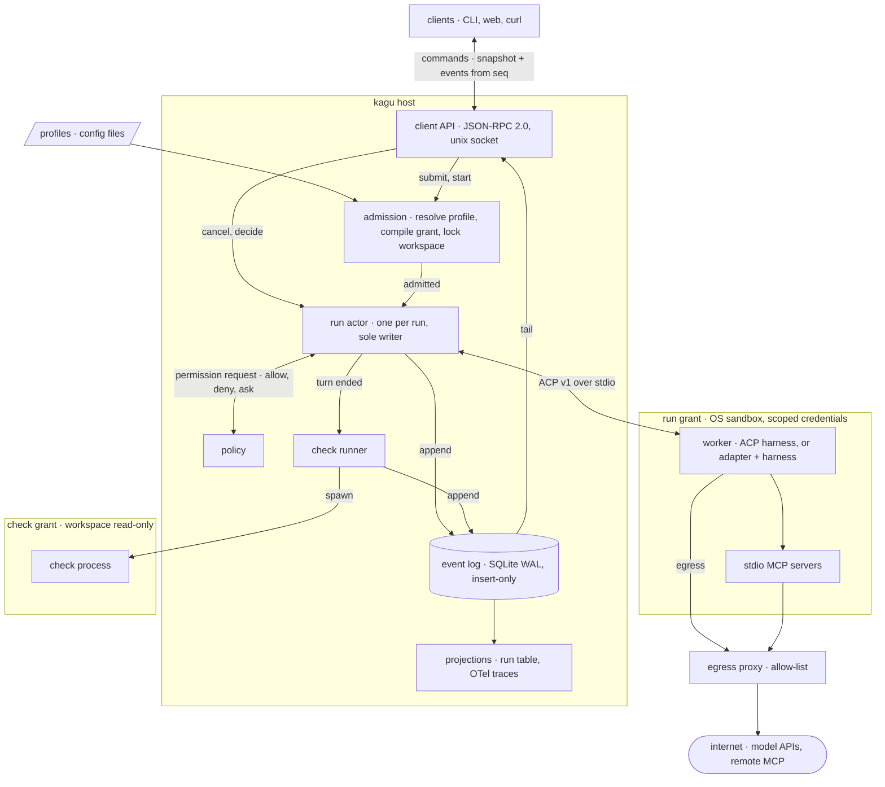
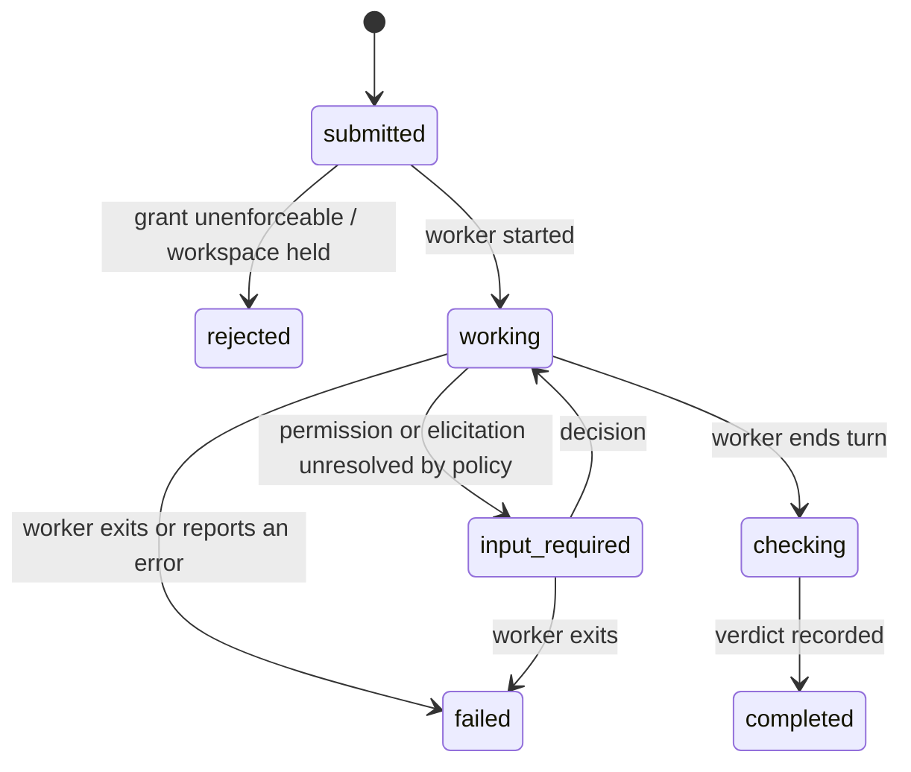

# kagu specification

Draft. Normative words (MUST, MUST NOT, SHOULD) per RFC 2119.

## Scope

kagu is a host. It accepts tasks, starts harnesses as worker processes,
confines them, records what they report, and records whether their result
was verified.

kagu does not implement an agent loop, call a model, implement tools, or route
work between models. A minimal native loop is a worker like any other.



## Model

| Noun    | Is                                                                      | Lifetime        |
| ------- | ----------------------------------------------------------------------- | --------------- |
| Profile | Configured worker: harness command, instructions, model hint, grant, checks | config, versioned |
| Task    | Immutable intent: profile name, input, workspace, checks                 | until deleted   |
| Run     | One attempt at a task by one worker, bound to its resolved configuration | to a terminal state |
| Event   | Append-only record of something that happened to a run                   | forever         |
| Grant   | Authority a run's worker holds, enforced outside the worker              | one run         |
| Check   | Command whose exit status contributes to the run's verdict               | one run         |

A retry is a new Run of the same Task. A harness's own session id is a field
of the Run, used to resume; kagu has no session object of its own (see open
questions).

## Invariants

1. **Log first.** Every state change is an appended Event before it takes
   effect. Run state is a fold over its Events; every other table is a
   projection and can be rebuilt.
2. **Single writer.** Exactly one host task mutates a given Run.
3. **At most once.** kagu never starts agent work again on its own. A run
   that ends, for any reason, stays ended; continuing is a new Run started by
   a command. This bounds what kagu starts, not what a worker did: effects
   made before a crash may be partial and unrecorded.
4. **Terminal is final.** `completed`, `failed`, `canceled`, `rejected` and
   `interrupted` have no outgoing transitions.
5. **Bound at admission.** A Run executes the configuration resolved when it
   was admitted. Later edits to a Profile do not reach it.
6. **Authority is what the process can reach.** A worker's authority is
   everything its process tree can reach, not what the Grant lists. Each
   grant field is reported `enforced`, `advisory` or `unsupported`; only
   `enforced` is a guarantee.
7. **Fail closed.** A run whose profile requires an enforcement the host
   cannot provide is `rejected` at admission.
8. **One writer per workspace.** At most one non-terminal run holds write
   access to a path, compared by canonical real path, with an ancestor or
   descendant counting as the same path. The lock is a projection of
   non-terminal runs, so it cannot outlive its run.
9. **Observed, not invented.** Every worker exit the host observes is an
   Event. A run whose end the host did not observe becomes `interrupted`;
   no exit is recorded for it.
10. **Verified means checked.** A verdict of `pass` requires every declared
    check to have run and exited `0`.
11. **No model in the control path.** Admission, supervision, policy, checks
    and the client API work with every model provider unreachable.
12. **Clients are not load-bearing.** Everything a client does is a
    documented call. Deleting every client loses no state.

## Run lifecycle

State names follow A2A task states, plus `interrupted`.



Not drawn: every non-terminal state goes to `canceled` on `run.cancel`, and
to `interrupted` on host recovery.

**Execution and verification are separate.** The state says how execution
ended. The verdict says whether its result was checked:

| Verdict   | Meaning                                                   |
| --------- | --------------------------------------------------------- |
| `pass`    | every check ran and exited `0`                            |
| `fail`    | a check exited `1`, or a protected path changed           |
| `error`   | a check could not run, timed out, or exited otherwise     |
| `not_run` | no checks declared, or the run never reached `checking`  |

`fail` takes precedence over `error`, and `error` over `pass`. A `completed`
run with verdict `not_run` executed to the end and was not verified.

**Containment.** The host kills a run's whole process tree on cancel,
failure or host shutdown, through the substrate's containment (a PID
namespace under bwrap). Under
substrate `none` there is no containment: the `process_tree` field is
`unsupported` and descendants may outlive the host.

**Recovery.** On host start, each non-terminal Run gets a `run.interrupted`
Event with `source: "host"` and moves to `interrupted`. The worker's
effects up to that point are unknown.

## Admission

Admission resolves the Task's profile and records a `run.admitted` Event
holding the resolved configuration: profile name and content digest, worker
command, effective grant with each field's level, checks, protected paths
with their digests. When the worker starts, its name and version from ACP
`initialize` are recorded.

## Checks

Checks run after the worker ends its turn, under their own grant: workspace
read-only, none of the worker's credentials, network only as the check
declares. They never run under the worker's grant.

Files a check reads from the workspace were writable by the worker, so a
verdict is only as independent as its inputs. A Task may list protected
paths, such as the tests a check runs; if any changed during the run, the
verdict is `fail`.

## Event envelope

```json
{ "seq": 4182, "run": "r_01J…", "ts": "2026-11-08T16:02:11.413Z",
  "source": "worker", "type": "worker.update", "v": 1, "data": { … } }
```

- `seq`: host-wide, strictly increasing, assigned at commit. Gaps are
  allowed. A client's cursor is the last `seq` it processed.
- `source`: `host`, `worker` or `client`. Events the host infers are
  `host`, never `worker`.
- `type` + `v`: the data schema. Readers upcast old versions; stored
  history is never rewritten.

Worker output is recorded as `worker.update`, whose data is the ACP v1
`SessionUpdate` unmodified. ACP is the presentation vocabulary: a client
needs no harness-specific knowledge to render a run. Anything outside ACP
(adapter `_meta`, frames from a native driver) is stored opaque as
`worker.raw`, for diagnostics.

Storage: one SQLite database in WAL mode. Events are insert-only.

## Grant

A Grant is data: filesystem paths (`ro` | `rw`), egress allow-list,
environment and credentials passed in, resource limits. The host compiles it
to a substrate and reports each field's level per run:

- `enforced`: the substrate prevents a violation.
- `advisory`: only the worker is asked to comply, through harness settings
  or ACP permission requests.
- `unsupported`: nothing applies.

| Substrate        | filesystem  | network                                       | credentials                    | process tree |
| ---------------- | ----------- | --------------------------------------------- | ------------------------------ | ------------ |
| `none`           | advisory or unsupported | advisory or unsupported           | unsupported                    | unsupported  |
| `bwrap+landlock` | enforced    | enforced: no network at all                   | enforced: env cleared, only granted paths mounted | enforced |
| `srt`            | enforced    | enforced: allow-listed domains through a host proxy, direct network removed | enforced | enforced |
| `vm`             | later       |                                               |                                |              |

A domain allow-list is enforced only while the worker has no route out
other than the proxy. The host probes the substrate at start (for Landlock,
its ABI version); a documented gap in the substrate downgrades the affected
field.

ACP `session/request_permission` is advisory: the confined program decides
whether to ask. kagu still answers, from policy first; only unresolved
requests reach clients, and the first decision recorded wins.

## Protocols

| Boundary        | Protocol                                   | Notes |
| --------------- | ------------------------------------------ | ----- |
| host ↔ worker   | ACP, `protocolVersion: 1`, stdio          | stable methods only; non-ACP harnesses get an adapter process |
| client ↔ host   | JSON-RPC 2.0, NDJSON over a unix socket (mode 0600) | AHP sync model, below |
| worker ↔ tools  | MCP                                        | passed through; kagu supplies configuration only |
| traces          | OpenTelemetry GenAI, pinned semconv version | a projection of the log |

Client methods: `task.submit`, `run.start`, `run.cancel`, `request.decide`,
`log.subscribe`, `log.read`, `profile.list`, `host.status`.

`log.subscribe { after? }` reads a snapshot of non-terminal runs and the
highest committed `seq` in one read transaction, returns both, then streams
every Event with a greater `seq`. Nothing committed after the snapshot is
missed or sent twice. A reconnecting client passes its cursor as `after`;
the log is never truncated, so replay is always possible.

## Adapter conformance

Each adapter declares the ACP features it supports (resume, cancel,
permission requests, elicitation) and is tested against them by a shared
suite. A run that needs an undeclared feature is `rejected`.

## Open questions

- Profile format: TOML or YAML, and whether its JSON Schema is the source of
  truth.
- Workspace allocation: caller-provided path, or a host-created git worktree.
- A user-facing conversation that groups Tasks across workers, so one
  thread survives a change of worker. Needed before the first interactive
  client; not needed for the host.
