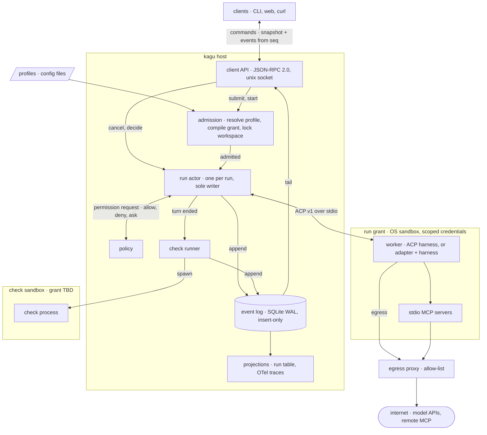
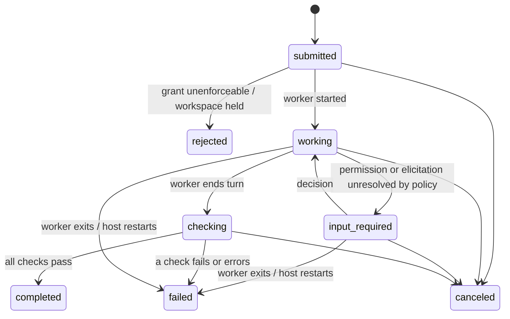

# kagu specification

Draft. Normative words (MUST, MUST NOT, SHOULD) per RFC 2119.

## Scope

kagu is a host. It accepts tasks, starts harnesses as worker processes,
confines them, records everything they report, and decides when a run is done.

kagu does not implement an agent loop, call a model, implement tools, or route
work between models. A minimal native loop is a worker like any other.



## Model

| Noun    | Is                                                                      | Lifetime        |
| ------- | ----------------------------------------------------------------------- | --------------- |
| Profile | Configured worker: harness command, instructions, model hint, grant, checks | config, versioned |
| Task    | Immutable intent: profile, input, workspace, checks                      | until deleted   |
| Run     | One attempt at a task by one worker process                              | to a terminal state |
| Event   | Append-only record of something that happened to a run                   | forever         |
| Grant   | Authority a run's worker holds, enforced outside the worker              | one run         |
| Check   | Command whose exit status decides whether a run succeeded                | one run         |

A retry is a new Run of the same Task. A harness's own session id is a field
of the Run, used to resume; kagu has no session object of its own.

## Invariants

1. **Log first.** Every state change is an appended Event before it takes
   effect. Run state is a fold over its Events; every other table is a
   projection and can be rebuilt.
2. **Single writer.** Exactly one host task mutates a given Run.
3. **At most once.** kagu never re-executes agent work on its own. A crash,
   timeout or failed check ends the run; continuing is a new Run started by a
   command.
4. **Terminal is final.** `completed`, `failed`, `canceled` and `rejected`
   have no outgoing transitions.
5. **No authority beyond the grant.** A worker holds only what its Grant
   gives it. A grant field the host cannot enforce on this machine is
   reported `advisory`, never `enforced`.
6. **Fail closed.** A run whose profile requires an enforcement the host
   cannot provide is `rejected` at admission.
7. **One writer per workspace.** At most one non-terminal run holds write
   access to a given path.
8. **Every exit is an event.** Worker death, by any cause, is recorded.
9. **No model in the control path.** Admission, supervision, policy, checks
   and the client API work with every model provider unreachable.
10. **Clients are not load-bearing.** Everything a client does is a
    documented call. Deleting every client loses no state.

## Run lifecycle

State names follow A2A task states.



A run with no checks goes from `checking` straight to `completed`, and the
Run records that no checks ran. A check exits `0` for pass and `1` for fail;
any other result is an error and fails the run. Unknown is never a pass.

Workers die with the host. On host start, every non-terminal Run gets a
`host.restarted` Event and moves to `failed` (invariants 3, 8).

## Event envelope

```json
{ "seq": 4182, "run": "r_01J…", "ts": "2026-11-08T16:02:11.413Z",
  "type": "run.state", "v": 1, "data": { "to": "working" } }
```

- `seq`: host-wide, gapless, strictly increasing. Clients resume from it.
- `type` + `v`: the data schema. Readers upcast old versions; stored
  history is never rewritten.
- Raw harness frames (ACP `session/update` payloads and anything
  harness-native) are stored unparsed and referenced by `type: "worker.frame"`
  Events. kagu's own types never mirror a harness's format.

Storage: one SQLite database in WAL mode. Events are insert-only.

## Grant

A Grant is data: filesystem paths (`ro` | `rw`), egress allow-list,
environment and credentials passed in, resource limits. The host compiles it
to a substrate profile:

| Substrate        | Enforces                                                 |
| ---------------- | -------------------------------------------------------- |
| `none`           | nothing; every field is `advisory`                       |
| `bwrap+landlock` | filesystem view, no network namespace, rlimits          |
| `srt`            | as above, plus domain allow-list through a host proxy   |
| `vm`             | later                                                    |

The host probes the substrate at start (for Landlock, its ABI version) and
reports each field's level per run: `enforced` | `advisory`. Credentials not
passed in are not reachable, whatever the substrate.

Harness-side permission settings and ACP `session/request_permission` are
**advisory**: the confined program decides whether to ask. kagu still
answers them, from policy first; only unresolved requests reach clients, and
the first decision recorded wins.

## Protocols

| Boundary        | Protocol                                   | Notes |
| --------------- | ------------------------------------------ | ----- |
| host ↔ worker   | ACP, `protocolVersion: 1`, stdio          | stable methods only; non-ACP harnesses get an adapter process |
| client ↔ host   | JSON-RPC 2.0, NDJSON over a unix socket (mode 0600) | AHP sync model, below |
| worker ↔ tools  | MCP                                        | passed through; kagu supplies configuration only |
| traces          | OpenTelemetry GenAI, pinned semconv version | a projection of the log |

Client methods: `task.submit`, `run.start`, `run.cancel`, `request.decide`,
`log.subscribe`, `log.read`, `profile.list`, `host.status`.

`log.subscribe { from_seq? }` returns a snapshot of non-terminal runs and the
`seq` it reflects, then streams Events after it. A client that reconnects
passes its last seen `seq` and receives every Event after it; the log is
never truncated, so replay is always possible.

## Adapter conformance

Each adapter declares the ACP features it supports (resume, cancel,
permission requests, elicitation) and is tested against them by a shared
suite. A run that needs an undeclared feature is `rejected`.

## Open questions

- Profile format: TOML or YAML, and whether its JSON Schema is the source of
  truth.
- Whether checks run inside the run's grant or a separate one.
- Workspace allocation: caller-provided path, or a host-created git worktree.
