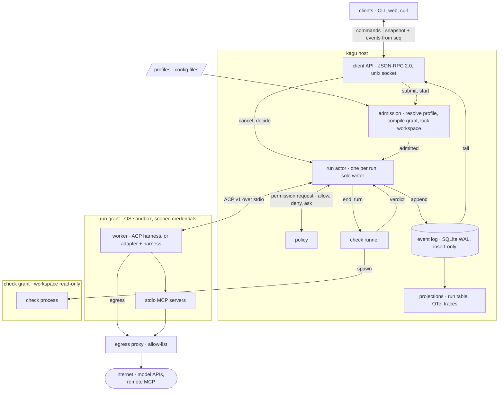
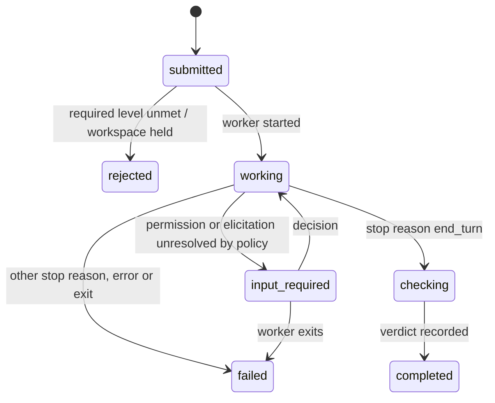

# kagu specification

Draft. Normative words (MUST, MUST NOT, SHOULD) per RFC 2119.

## Scope

kagu is a host. It accepts tasks, starts harnesses as worker processes,
confines them, records what they report, and records whether their result
was verified.

kagu does not implement an agent loop, call a model, implement tools, or route
work between models. A minimal native loop is a worker like any other.



## Model

| Noun    | Is                                                                      | Lifetime        |
| ------- | ----------------------------------------------------------------------- | --------------- |
| Profile | Configured worker: harness command, instructions, model hint, grant, checks | config, versioned |
| Task    | Immutable intent: profile name, input, workspace, checks                 | until deleted   |
| Run     | One attempt at a task by one worker, bound to its resolved configuration | to a terminal state |
| Event   | Append-only record of something that happened to a run                   | forever         |
| Grant   | Authority a run's worker holds; credentials by reference, never by value | one run         |
| Check   | Command whose exit status contributes to the run's verdict               | one run         |

A retry is a new Run of the same Task. A harness's own session id is a field
of the Run, used to resume; kagu has no session object of its own (see open
questions).

## Invariants

1. **Log first.** Every state change is an appended Event before it takes
   effect. Run state is a fold over its Events; every other table is a
   projection and can be rebuilt.
2. **Single writer.** Only a Run's actor appends its Events. Admission,
   checks, policy and clients send it messages. A terminal Run's actor is
   revived on demand to record release, recovery or purge.
3. **At most once.** kagu never starts agent work again on its own. A run
   that ends, for any reason, stays ended; continuing is a new Run started by
   a command. This bounds what kagu starts, not what a worker did: effects
   made before a crash may be partial and unrecorded.
4. **Terminal is final.** `completed`, `failed`, `canceled`, `rejected` and
   `interrupted` have no outgoing transitions.
5. **Bound at admission.** A Run executes the configuration resolved when it
   was admitted. Later edits to a Profile do not reach it.
6. **Authority is what the process can reach.** A worker's authority is
   everything its process tree can reach, not what the Grant lists. Every
   setting is reported at one of the levels under
   [Enforcement levels](#enforcement-levels); only `enforced` is a guarantee.
7. **Fail closed.** A run whose profile requires a level the host or
   adapter cannot provide for a setting is `rejected` at admission.
8. **One writer per workspace.** At most one non-terminal run holds write
   access to a path, compared by canonical real path, with an ancestor or
   descendant counting as the same path. A lock is held from admission
   until the run is terminal **and** its process tree is confirmed gone
   (see [Release](#release)); a terminal run alone does not free it.
9. **Observed, not invented.** Every worker exit the host observes is an
   Event. A run whose end the host did not observe becomes `interrupted`;
   no exit is recorded for it.
10. **Verified means checked.** A verdict of `pass` requires every declared
    check to have run and exited `0`.
11. **No model in the control path.** Admission, supervision, policy, checks
    and the client API work with every model provider unreachable.
12. **Clients are not load-bearing.** Everything a client does is a
    documented call. Deleting every client loses no state.
13. **No secret values at rest.** Credential values never enter the
    resolved configuration or the log. Profiles and Grants name secrets by
    reference; the host resolves them only when starting a process.

## Run lifecycle

State names follow A2A task states, plus `interrupted`.



Not drawn: every non-terminal state goes to `canceled` on `run.cancel`, and
to `interrupted` on host recovery.

A Run sends one ACP `session/prompt`. Its response ends execution:

| Response                         | Next state  | Reason recorded       |
| -------------------------------- | ----------- | --------------------- |
| `end_turn`                       | `checking`  |                       |
| `cancelled` after `run.cancel`   | `canceled`  |                       |
| `cancelled` without `run.cancel` | `failed`    | `unrequested_cancel`  |
| `max_tokens`                     | `failed`    | `limit`               |
| `max_turn_requests`              | `failed`    | `limit`               |
| `refusal`                        | `failed`    | `refusal`             |
| any other stop reason            | `failed`    | `unknown_stop_reason` |
| JSON-RPC error                   | `failed`    | `error`               |
| worker exits before responding   | `failed`    | `exited`              |

`end_turn` means only that execution finished; whether the result is good
is the verdict. On `run.cancel` the actor sends `session/cancel`, answers
pending permission requests with `cancelled`, and kills the process tree if
no response arrives within the profile's grace period.

**Execution and verification are separate.** The state says how execution
ended. The verdict says whether its result was checked:

| Verdict   | Meaning                                                   |
| --------- | --------------------------------------------------------- |
| `pass`    | every check ran and exited `0`                            |
| `fail`    | a check exited `1`, or a protected path changed           |
| `error`   | a check could not run, timed out, or exited otherwise     |
| `not_run` | no checks declared, or the run never reached `checking`  |

`fail` takes precedence over `error`, and `error` over `pass`. A `completed`
run with verdict `not_run` executed to the end and was not verified.

**Containment.** The host kills a run's whole process tree on cancel,
failure or host shutdown, through the substrate's containment (a PID
namespace under bwrap). Under
substrate `none` there is no containment: the `process_tree` field is
`unsupported` and descendants may outlive the host.

**Recovery.** On host start, each non-terminal Run gets a `run.interrupted`
Event with `source: "host"` and moves to `interrupted`. The worker's
effects up to that point are unknown.

### Release

The actor records the root process at start (pid and start time) and
appends `run.released` once the whole tree is confirmed gone:

- **Contained** (`process_tree` enforced): the root's exit, observed or
  found on recovery by pid and start time, ends the namespace and every
  descendant. Release follows.
- **Not contained:** descendants cannot be accounted for. The lock stays
  held until a client calls `workspace.release`, recorded with
  `source: "client"` as an attestation, not an observation.

## Admission

Admission resolves the Task's profile and hands the result to the new
Run's actor, which records it as `run.admitted`: profile name and content digest, worker
command, effective grant, the level of every setting, checks, protected
paths with their digests. Credentials appear as references. When the worker starts, its name and version from ACP
`initialize` are recorded.

## Checks

Checks run after the worker ends its turn, under their own grant: workspace
read-only, none of the worker's credentials, network only as the check
declares. They never run under the worker's grant.

Files a check reads from the workspace were writable by the worker, so a
verdict is only as independent as its inputs. A Task may list protected
paths, such as the tests a check runs; if any changed during the run, the
verdict is `fail`.

## Event envelope

```json
{ "seq": 4182, "run": "r_01J…", "ts": "2026-11-08T16:02:11.413Z",
  "source": "worker", "type": "worker.update", "v": 1, "data": { … } }
```

- `seq`: host-wide, strictly increasing, assigned at commit. Gaps are
  allowed. A client's cursor is the last `seq` it processed.
- `source`: `host`, `worker` or `client`. Events the host infers are
  `host`, never `worker`.
- `type` + `v`: the data schema. Readers upcast old versions; stored
  history is never rewritten, only purged (below).

Worker output is recorded as `worker.update`, whose data is the ACP v1
`SessionUpdate` unmodified. ACP is the presentation vocabulary: a client
needs no harness-specific knowledge to render a run. Anything outside ACP
(adapter `_meta`, frames from a native driver) is stored opaque as
`worker.raw`, for diagnostics.

Before append, the actor replaces every credential value it injected into
the run with its reference. Secrets the worker obtained some other way
cannot be recognised and are not redacted; the grant is what keeps them out
of reach.

Storage: one SQLite database in WAL mode, `secure_delete` on. Events are
insert-only, except purge: `run.purge`, or the host's retention age for
terminal runs (default: keep), deletes a released run's Events and leaves
one `run.purged` Event. A replaying client sees the deleted `seq` values
as gaps.

## Grant

A Grant is data: filesystem paths (`ro` | `rw`), egress allow-list,
environment and credential references, resource limits. The host compiles it
to a substrate.

### Enforcement levels

Every Profile setting, grant fields and worker settings alike (model, mode,
instructions, MCP servers), is reported at one level per run:

| Level         | Meaning                                                                 |
| ------------- | ----------------------------------------------------------------------- |
| `enforced`    | the host prevents a violation through the substrate                     |
| `supported`   | the adapter declares it applies the setting, and the conformance suite tests that it does; not a security boundary |
| `advisory`    | passed to the worker; compliance is neither enforced nor tested        |
| `unsupported` | cannot be passed or applied                                             |

A Profile may mark a setting `required: <level>`. Admission rejects the run
if the setting's level is lower. Only grant fields can be `enforced`.

| Substrate        | filesystem  | network                                       | credentials                    | process tree |
| ---------------- | ----------- | --------------------------------------------- | ------------------------------ | ------------ |
| `none`           | supported, advisory or unsupported | supported, advisory or unsupported | unsupported                    | unsupported  |
| `bwrap+landlock` | enforced    | enforced: no network at all                   | enforced: env cleared, only granted paths mounted | enforced |
| `srt`            | enforced    | enforced: allow-listed domains through a host proxy, direct network removed | enforced | enforced |
| `vm`             | later       |                                               |                                |              |

A domain allow-list is enforced only while the worker has no route out
other than the proxy. The host probes the substrate at start (for Landlock,
its ABI version); a documented gap in the substrate downgrades the affected
field.

ACP `session/request_permission` is advisory: the confined program decides
whether to ask. kagu still answers, from policy first; only unresolved
requests reach clients, and the first decision recorded wins.

## Protocols

| Boundary        | Protocol                                   | Notes |
| --------------- | ------------------------------------------ | ----- |
| host ↔ worker   | ACP, `protocolVersion: 1`, stdio          | stable methods only; non-ACP harnesses get an adapter process |
| client ↔ host   | JSON-RPC 2.0, NDJSON over a unix socket (mode 0600) | AHP sync model, below |
| worker ↔ tools  | MCP                                        | passed through; kagu supplies configuration only |
| traces          | OpenTelemetry GenAI, pinned semconv version | a projection of the log |

Client methods: `task.submit`, `run.start`, `run.cancel`, `request.decide`,
`workspace.release`, `run.purge`, `log.subscribe`, `log.read`,
`profile.list`, `host.status`.

`log.subscribe { after? }` reads a snapshot of non-terminal runs and the
highest committed `seq` in one read transaction, returns both, then streams
every Event with a greater `seq`. Nothing committed after the snapshot is
missed or sent twice. A reconnecting client passes its cursor as `after`;
replay is always possible; purged runs appear as gaps.

## Adapter conformance

Each adapter declares the ACP features it supports (resume, cancel,
permission requests, elicitation) and the settings it applies, and is tested
against them by a shared suite. A declared setting that passes the suite is
`supported`; one passed without a test is `advisory`. A run that needs an
undeclared feature is `rejected`.

## Open questions

- Profile format: TOML or YAML, and whether its JSON Schema is the source of
  truth.
- Workspace allocation: caller-provided path, or a host-created git worktree.
- A user-facing conversation that groups Tasks across workers, so one
  thread survives a change of worker. Needed before the first interactive
  client; not needed for the host.
