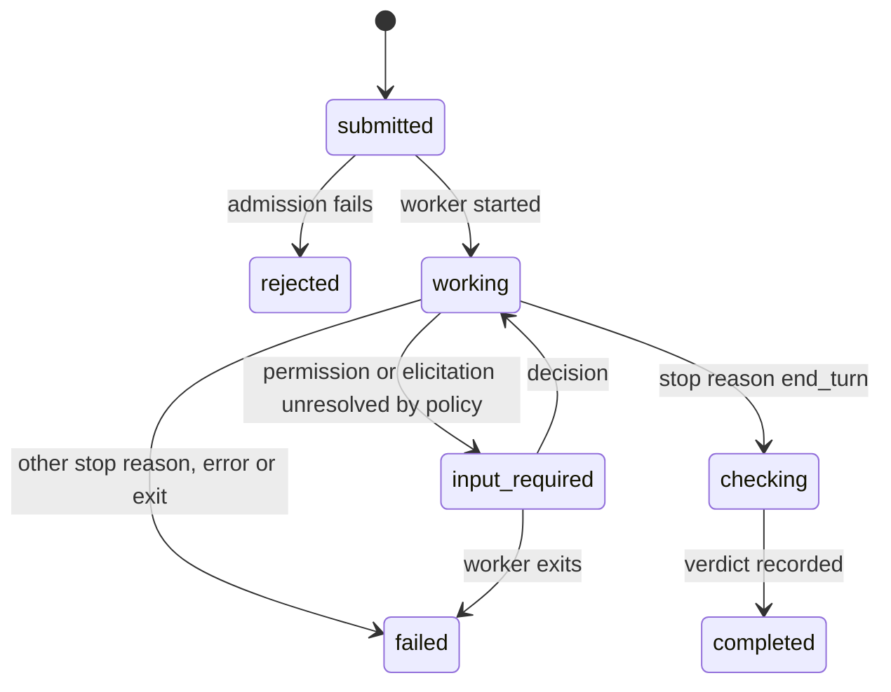

# kagu specification

Draft. Normative words (MUST, MUST NOT, SHOULD) per RFC 2119.

## Scope

kagu is a host. It accepts tasks, starts harnesses as worker processes,
confines them, records what they report, and records whether their result
was verified.

kagu does not implement an agent loop, call a model, implement tools, route
work between models, or authenticate to a model provider. A minimal native
loop is a worker like any other. v1 targets Linux.


## Model

| Noun    | Is                                                                      | Lifetime        |
| ------- | ----------------------------------------------------------------------- | --------------- |
| Profile | Configured worker: harness command, auth, instructions, model hint, grant, checks; owns a harness home | config, versioned |
| Task    | Immutable intent: profile name, input, workspace directory, checks, optional `thread` | until deleted   |
| Run     | One attempt at a task by one worker, bound to its resolved configuration | to a terminal state |
| Event   | Append-only record of something that happened to a run                   | forever         |
| Grant   | Authority a run's worker holds; credentials by reference, never by value | one run         |
| Check   | Command whose exit status contributes to the run's verdict               | one run         |

A retry is a new Run of the same Task. A harness's own session id is a field
of the Run, used to resume; kagu has no session object of its own. `thread`
is a label clients may group Tasks by; kagu's only use of it is to carry it
across a continuation.

A continuation (`task.continue`) is a new Task with the earlier run's profile
and workspace, in its thread, recording which run it `continues`. Its run
resumes that run's worker session with ACP `session/resume` instead of
`session/new`, and fails if the worker does not offer resume. A run can be
continued once, so a chain stays linear and each run resumes exactly the
history its log shows. Only a run
that has ended can be continued.

The workspace is a directory the caller names. kagu locks it (invariant 8)
and grants it; it does not create, clone or otherwise manage it.

## Invariants

1. **Log first.** Every state change is an appended Event before it takes
   effect. Run state is a fold over its Events; every other table is a
   projection and can be rebuilt.
2. **Single writer.** Only a Run's actor appends its Events. Admission,
   checks, policy and clients send it messages. A terminal Run's actor is
   revived on demand to record release, recovery or purge.
3. **At most once.** kagu never starts agent work again on its own. A run
   that ends, for any reason, stays ended; continuing is a new Run started by
   a command. This bounds what kagu starts, not what a worker did: effects
   made before a crash may be partial and unrecorded.
4. **Terminal is final.** `completed`, `failed`, `canceled`, `rejected` and
   `interrupted` have no outgoing transitions.
5. **Bound at admission.** A Run executes the configuration resolved when it
   was admitted. Later edits to a Profile do not reach it.
6. **Authority is what the process can reach.** A worker's authority is
   everything its process tree can reach, not what the Grant lists. Every
   setting is reported at one of the levels under
   [Enforcement levels](#enforcement-levels), or as `unrestricted` when its
   value requests no restriction; only `enforced` is a guarantee.
7. **Fail closed.** A run whose profile requires a level the host or
   adapter cannot provide for a setting is `rejected` at admission.
8. **One writer per workspace.** At most one non-terminal run holds write
   access to a workspace, compared by canonical real path, with an ancestor
   or descendant counting as the same path. A profile's harness home is not
   a workspace: its runs share it, and the harness coordinates its own use
   of it. A lock is held from admission
   until the run is terminal **and** its process tree is confirmed gone
   (see [Release](#release)); a terminal run alone does not free it.
9. **Observed, not invented.** Every worker exit the host observes is an
   Event. A run whose end the host did not observe becomes `interrupted`;
   no exit is recorded for it.
10. **Verified means checked.** A verdict of `pass` requires every declared
    check to have run and exited `0`.
11. **No model in the control path.** Admission, supervision, policy, checks
    and the client API work with every model provider unreachable.
12. **Clients are not load-bearing.** Everything a client does is a
    documented call. Deleting every client loses no state.
13. **No secret values at rest.** Credential values never enter the
    resolved configuration or the log. Profiles and Grants name secrets by
    reference; the host resolves them only when starting a process.

## Run lifecycle

State names follow A2A task states, plus `interrupted`.



Not drawn: every non-terminal state goes to `canceled` on `run.cancel`, and
to `interrupted` on host recovery.

Admission fails, and the run is `rejected` with reason `error` and a
detail, when the profile is invalid, a credential reference is unset, a
required level is unmet, the workspace is held, or the worker cannot be
started. A rejected run never reached `working`.

A Run sends one ACP `session/prompt`. A failure before it ends the run
`failed`: reason `auth_required` for ACP error `-32000` from `initialize` or
`session/new`, `exited` if the worker exited, `error` otherwise. The
prompt's response ends execution:

| Response                         | Next state  | Reason recorded       |
| -------------------------------- | ----------- | --------------------- |
| `end_turn`                       | `checking`  |                       |
| `cancelled` after `run.cancel`   | `canceled`  |                       |
| `cancelled` without `run.cancel` | `failed`    | `unrequested_cancel`  |
| `max_tokens`                     | `failed`    | `limit`               |
| `max_turn_requests`              | `failed`    | `limit`               |
| `refusal`                        | `failed`    | `refusal`             |
| any other stop reason            | `failed`    | `unknown_stop_reason` |
| ACP auth-required error (`-32000`) | `failed`  | `auth_required`       |
| other JSON-RPC error             | `failed`    | `error`               |
| worker exits before responding   | `failed`    | `exited`              |

`end_turn` means only that execution finished; whether the result is good
is the verdict. On `run.cancel` the actor sends `session/cancel`, answers
pending permission requests with `cancelled`, and kills the process tree if
no response arrives within the profile's grace period.

**Execution and verification are separate.** The state says how execution
ended. The verdict says whether its result was checked:

| Verdict   | Meaning                                                   |
| --------- | --------------------------------------------------------- |
| `pass`    | every check ran and exited `0`                            |
| `fail`    | a check exited `1`, or a protected path changed           |
| `error`   | a check could not run, timed out, or exited otherwise     |
| `not_run` | no checks declared, or the run never reached `checking`  |

`fail` takes precedence over `error`, and `error` over `pass`. A `completed`
run with verdict `not_run` executed to the end and was not verified.

**Containment.** The host kills a run's whole process tree on cancel,
failure or host shutdown, through the substrate's containment (a PID
namespace under bwrap). Under substrate `none` there is no containment: the
`process_tree` field is `unsupported` and descendants may outlive the host.

**Recovery.** On host start, each non-terminal Run gets a `run.state` Event
to `interrupted` with `source: "host"`. One host serves a log at a time:
`kagu serve` takes an exclusive advisory lock on `<db>.lock` before it
reads or writes the log, and holds it while serving. The worker's
effects up to that point are unknown. A recorded root still alive (same pid
and start time) is killed through a pidfd before release is considered.

Workers are spawned with `--die-with-parent` from the run's actor thread,
which outlives the worker it spawns: the parent-death signal follows the
spawning thread, not the process.

### Release

The actor records the root process at start (pid and start time) and
appends `run.released` once the whole tree is confirmed gone:

- **Contained** (`process_tree` enforced): the root's exit, observed or
  found on recovery by pid and start time, ends the namespace and every
  descendant. Release follows.
- **Not contained:** descendants cannot be accounted for. The lock stays
  held until a client calls `workspace.release`, recorded with
  `source: "client"` as an attestation, not an observation.

## Admission

Admission resolves the Task's profile and hands the result to the new
Run's actor, which records it as `run.admitted`: profile name and content
digest, worker command, effective grant, the level of every setting,
checks, protected paths with their digests. Credentials appear as
references. When the worker starts, its name and version from ACP
`initialize` are recorded.

## Harness home

Each Profile owns a harness home: a directory the host creates and passes
to the worker through the harness's state variables (`CLAUDE_CONFIG_DIR`;
`CODEX_HOME`; OpenCode's `XDG_DATA_HOME` and `XDG_STATE_HOME`). It is
granted read-write to every run of the profile and holds the harness's
state: its login and transcripts. It lives at
`$XDG_STATE_HOME/kagu/homes/<profile>`, mode 0700, and the profile names the
variables that point at it:

```toml
[worker]
command = ["claude-agent-acp"]
home_env = ["CLAUDE_CONFIG_DIR"]
system_prompt = { mode = "append", text = "..." }   # ACP session/new systemPrompt

[worker.meta.claudeCode.options]                   # the adapter's _meta, as is
settingSources = []
```

The home is state, not configuration. A worker can write it, so whatever
one run leaves there must not configure the next (invariant 5):

- Configuration is passed per run: ACP `session/new` (system prompt, MCP
  servers), `session/set_mode`, `session/set_config_option`, the
  adapter's `_meta` options, or the environment. `run.admitted` records it.
- The harness's own configuration sources in the home are not loaded (for
  Claude Code, `settingSources` without `user`). A harness that cannot
  exclude them gets the files kagu writes bound read-only over them.
- `HOME`, `XDG_CONFIG_HOME`, `XDG_CACHE_HOME`, `XDG_RUNTIME_DIR` and
  `TMPDIR` are a fresh tmpfs per run, so dotfiles a run writes (`.bashrc`,
  git config) are gone before the next.

The adapter conformance suite plants configuration in the home (settings,
hooks, MCP servers, wherever the harness reads them) and checks the next
run ignores it. An adapter that passes reports home isolation `supported`;
otherwise it is `advisory`.

Using the user's own harness directory (for example `~/.claude`) means
making it the home: the worker then reaches its settings, hooks and history
read-write. A profile does this only explicitly.

Harness configuration found in the workspace (`.claude/`, `.codex/`,
`.gemini/`, `opencode.json`, …) is not loaded unless the profile opts in per
source. A source covers everything the harness loads from it (for Claude
Code: settings, hooks, `CLAUDE.md`, `.mcp.json`). `run.admitted` records the
sources the worker was configured to load. These are worker settings, so
their level is at most `supported`.

## Auth

Authentication belongs to the worker. A profile declares one mode:

- `native`: the worker authenticates from its own credential store, which
  is its harness home. The home is granted as a directory because
  harnesses replace credential files by rename and take lock files beside
  them. kagu never opens it. `kagu auth <profile>` declares
  `clientCapabilities.auth.terminal` in ACP `initialize`, then runs the
  profile's worker command with the `args` and `env` of a `terminal` login
  method the worker advertises, attached to the user's terminal. It runs
  with the profile's home and network `host`, since login reaches the
  provider and may redirect the user's browser to loopback.
- `reference`: a credential the worker reads from its environment (an API
  key) is named by reference, resolved when the worker starts, and injected
  (invariant 13).

kagu does not implement login, refresh or token handling, and does not hide
or disable a method the worker advertises. A worker that reports
authentication required ends the run `failed`, reason `auth_required`.

## Checks

Checks run after the worker ends its turn, under their own grant: workspace
read-only, none of the worker's credentials, network only as the check
declares. They never run under the worker's grant.

Files a check reads from the workspace were writable by the worker, so a
verdict is only as independent as its inputs. A Task may list protected
paths, such as the tests a check runs; if any changed during the run, the
verdict is `fail`.

## Event envelope

```json
{ "seq": 4182, "run": "r_01J…", "ts": "2026-11-08T16:02:11.413Z",
  "source": "worker", "type": "worker.update", "v": 1, "data": { … } }
```

- `seq`: host-wide, strictly increasing, assigned at commit. Gaps are
  allowed. A client's cursor is the last `seq` it processed.
- `source`: `host`, `worker` or `client`. Events the host infers are
  `host`, never `worker`.
- `type` + `v`: the data schema. Readers upcast old versions; stored
  history is never rewritten, only purged (below).

Worker output is recorded as `worker.update`, whose data is the ACP v1
`SessionUpdate` unmodified. ACP is the presentation vocabulary: a client
needs no harness-specific knowledge to render a run. Anything outside ACP
(adapter `_meta`, frames from a native driver) is stored opaque as
`worker.raw`, for diagnostics.

Before append, the actor replaces every credential value it injected into
the run with its reference. Secrets the worker obtained some other way
cannot be recognised and are not redacted; the grant is what keeps them out
of reach.

Storage: one SQLite database in WAL mode, `secure_delete` on. Events are
insert-only, except purge: `run.purge`, or the host's retention age for
terminal runs (default: keep), deletes a released run's Events and leaves
one `run.purged` Event. A replaying client sees the deleted `seq` values
as gaps.

## Grant

A Grant is data: filesystem paths (`ro` | `rw`), network (`off` | `host` |
`allow-list`), environment and credential references, resource limits. The
host compiles it to a substrate.

### Enforcement levels

Every Profile setting, grant fields and worker settings alike (model, mode,
instructions, MCP servers), is reported at one level per run:

| Level         | Meaning                                                                 |
| ------------- | ----------------------------------------------------------------------- |
| `enforced`    | the host prevents a violation through the substrate                     |
| `supported`   | the adapter declares it applies the setting, and the conformance suite tests that it does; not a security boundary |
| `advisory`    | passed to the worker; compliance is neither enforced nor tested        |
| `unsupported` | cannot be passed or applied                                             |

A Profile may mark a setting `required: <level>`. Admission rejects the run
if the setting's level is lower. Only grant fields can be `enforced`. A
setting whose value requests no restriction (network `host`) is recorded as
`unrestricted` instead of a level, and fails any `required`.

| Substrate        | filesystem  | credentials                    | process tree |
| ---------------- | ----------- | ------------------------------ | ------------ |
| `none`           | supported, advisory or unsupported | unsupported | unsupported  |
| `bwrap+landlock` | enforced    | enforced, see below            | enforced     |
| `srt` (optional, external) | enforced | enforced           | enforced     |
| `vm`             | later       |                                |              |

The host starts `bwrap`, which builds the mount, PID and network
namespaces and runs `kagu sandbox-init` inside them. That helper applies
Landlock to itself with every right the host's probe found, refuses to run
the worker if the ruleset is not fully enforced, writes a readiness line to
stderr, and execs the worker. Landlock comes last because a
Landlock-restricted process cannot mount. A run reaches `working` only after
that line; a sandbox that fails to start rejects the run. A worker program
that starts but cannot run (an interpreter missing from the sandbox, say)
ends `failed`, reason `exited`, with its stderr in the log. A grant whose
`ro` path contains the workspace or an `rw` path is rejected, since it would
make that path read-only. The host probes
on first use, by running `sandbox-init --probe` inside `bwrap`: one call
shows both that a user namespace can be created and which Landlock ABI is in
force. A successful probe is kept; a failed one is retried by the next run.

Inside, the worker sees the system directories read-only, its workspace and
the grant's `rw` paths read-write, the grant's `ro` paths and its own
executable read-only (mounted after the writable paths, so a read-only path
inside a writable one stays read-only), and a fresh tmpfs at `/tmp` holding
`HOME` and the XDG directories. Its environment is set on `bwrap` itself,
never passed as arguments, which every user can read in `/proc`.

A profile's grant:

```toml
[grant]
substrate = "bwrap"   # default; or "none"
network = "host"      # default; or "off"
ro = ["/abs/path"]    # extra read-only paths
rw = ["/abs/path"]    # extra read-write paths
```

The network field takes one of three values:

| Network      | Effect                                                     |
| ------------ | ---------------------------------------------------------- |
| `off`        | an empty network namespace; `enforced`                     |
| `allow-list` | an empty network namespace whose only route is the egress proxy; `enforced` |
| `host`       | the host's network namespace is shared; a request for no restriction, recorded as `unrestricted` rather than given a level |

Credentials are `enforced` when the environment is cleared, only granted
paths are mounted, and no unix socket outside the sandbox is reachable
other than the egress proxy's.
With network `host`, abstract unix sockets are shared; they are closed only
by Landlock scoping (ABI 6 or later), and without it credentials are
`unsupported`. Services listening on the host's loopback are part of the
network, so `host` reaches them.

The host probes each substrate at start: bwrap version, Landlock ABI, and
whether user namespaces can be created. Where they cannot (inside a
container or an outer sandbox, or under a distribution's namespace
restriction), the substrate is unavailable and runs that require it are
`rejected`. A documented gap in a substrate downgrades the affected field.

ACP `session/request_permission` is advisory: the confined program decides
whether to ask. kagu still answers, from policy first; only unresolved
requests reach clients, and the first decision recorded wins. Until there is
a policy engine the policy is fixed: allow (`allow_once`) when the run's
filesystem level is `enforced`, since the sandbox is then the boundary, and
refuse (`reject_once`) otherwise.

## Protocols

| Boundary        | Protocol                                   | Notes |
| --------------- | ------------------------------------------ | ----- |
| host ↔ worker   | ACP, `protocolVersion: 1`, stdio          | stable methods only; non-ACP harnesses get an adapter process |
| client ↔ host   | JSON-RPC 2.0, NDJSON over a unix socket (mode 0600) | AHP sync model, below |
| worker ↔ tools  | MCP                                        | passed through; kagu supplies configuration only |
| traces          | OpenTelemetry GenAI, pinned semconv version | a projection of the log |

Client methods: `task.submit`, `run.start`, `run.cancel`, `request.decide`,
`workspace.release`, `run.purge`, `log.subscribe`, `log.read`,
`profile.list`, `host.status`.

`log.subscribe { after? }` reads a snapshot of non-terminal runs and the
highest committed `seq` in one read transaction, returns both, then streams
every Event with a greater `seq` as `log.event` notifications. Nothing committed after the snapshot is
missed or sent twice. A reconnecting client passes its cursor as `after`;
replay is always possible; purged runs appear as gaps.

## Contracts

Rust types are the source. JSON Schema (2020-12) is generated from them and
committed, one file per version: per Event `type` and `v`, per client API
version (reported by `host.status`), and per Profile `version` (a required
key). CI regenerates the files and fails on any difference. A change is
compatible if a newer host still reads everything an older one wrote or
accepted: adding an optional field is; any other change needs a new
version.

Profiles are TOML. Unknown keys are refused.

## Adapter conformance

Each adapter declares the ACP features it supports (resume, cancel,
permission requests, elicitation) and the settings it applies, and is tested
against them by a shared suite. A declared setting that passes the suite is
`supported`; one passed without a test is `advisory`. A run that needs an
undeclared feature is `rejected`.

## Formal model

The run lifecycle, release, recovery and `log.subscribe` MUST be specified
in TLA+ and checked with TLC in CI before the host implements them. The
model is `tla/kagu.tla`; `tla/MC.cfg` lists the properties checked.
